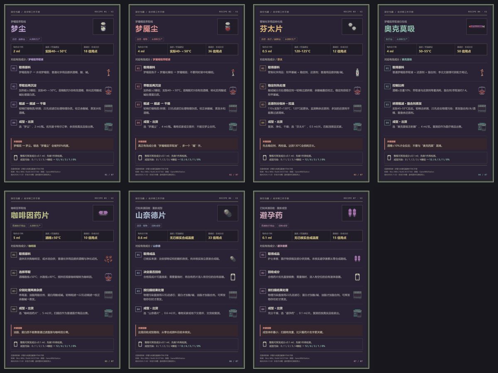

# 深空当铺 · 化学师工作手册

[在线浏览攻略](https://sherlock3rd.github.io/Breakingbad/)

《Probably Stolen / 深空当铺》的非官方游戏攻略，采用游戏原始像素图。所有配方、体积、温度和处理步骤仅描述游戏规则。

## 内容

- 全部7种化学成型品的来源、加工步骤、杂质处理与销售去向。
- 每个制作步骤的仪器、试剂、滤材对照图，标注按需使用与二选一关系。
- 8类仪器操作、模组适配和升级优先级。
- 18类扫描成分处理表、4种滤材的孔径与耐久、重复过滤说明。
- 纯度计算器、7张1200×1800配方卡及离线下载包。

山奈德片、避孕药的从零合成路线未核实，已明确标注为“回收成型”，只列已知成品来源及可确认的回收步骤。

## 文件

- `index.html`：网页入口，CSS与JavaScript内嵌，无需构建。
- `assets/`：游戏图标及案例截图。
- `recipes/`：7张独立2:3竖版配方总览。
- `downloads/chemist-guide-offline.zip`：全图内嵌的离线HTML与7张PNG。
- `.nojekyll`：使用GitHub Pages直接发布静态文件。

GitHub Pages从 `main` 分支根目录发布，后续提交会自动更新网站。

## 来源与权利

机制核对日期2026-11-02；逐步配图更新2026-11-03。主要依据非官方Nico Wiki的Build26337366资料，原图来自GameWikiStation；详细来源链接和版本说明保留在网页中。未在用户当前存档实测，游戏版本差异以游戏内显示为准。

游戏名称、图标和截图归各自权利人所有。本项目不是官方攻略。Nico Wiki文字改编部分按CC BY-SA 4.0保留来源与同许可；这不代表游戏美术素材也使用该许可。

